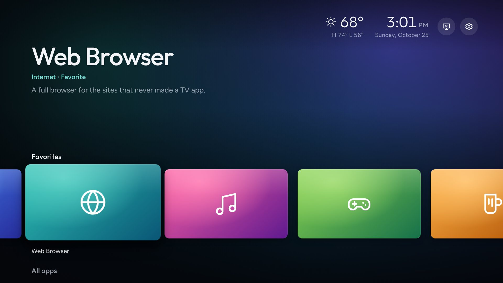
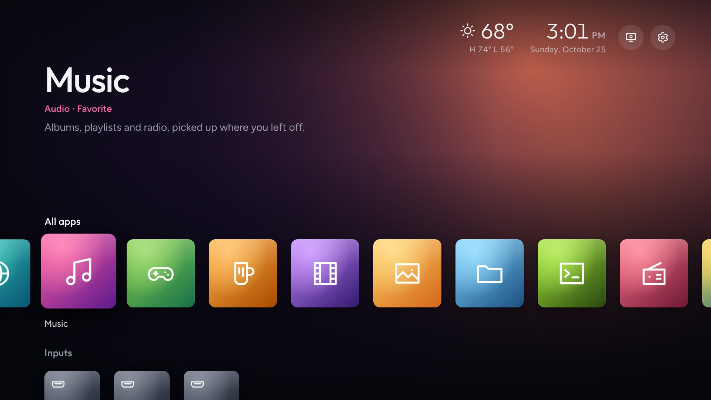
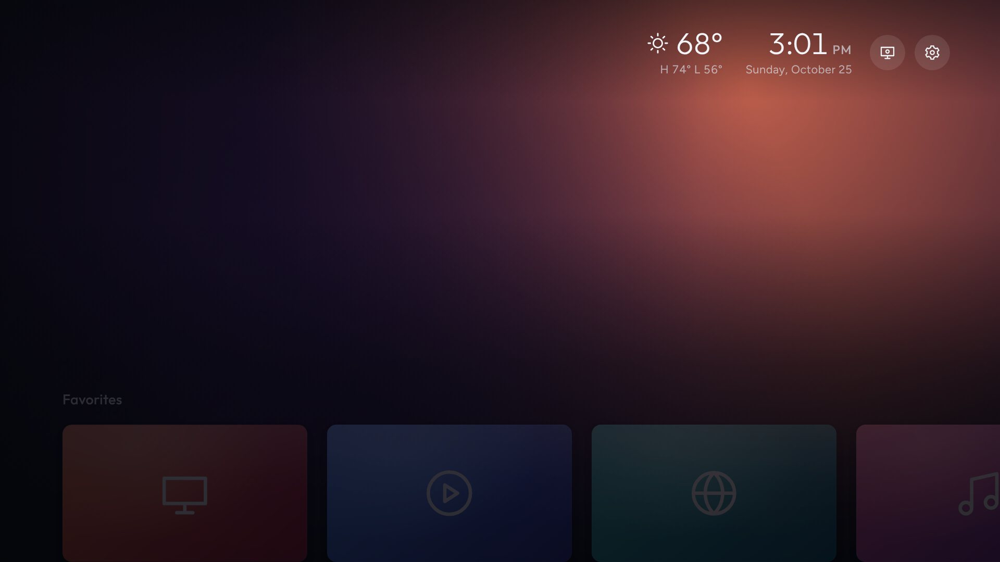
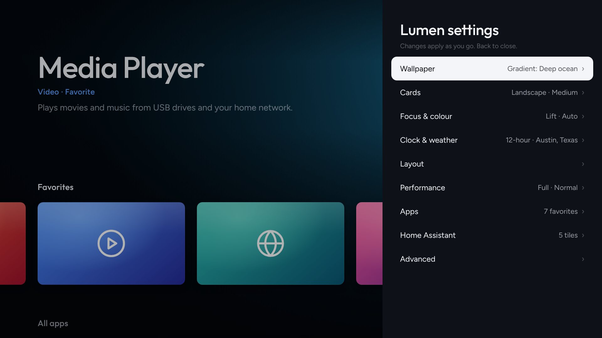
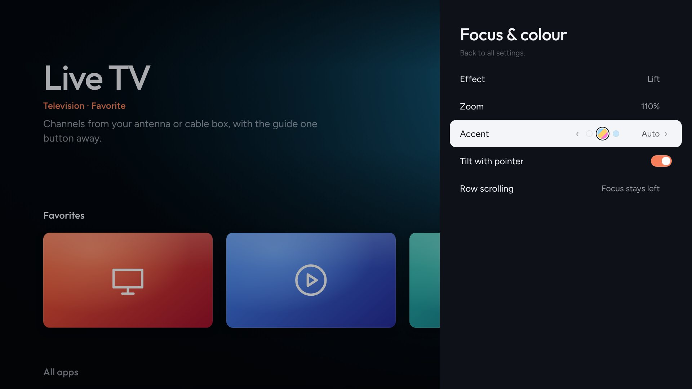
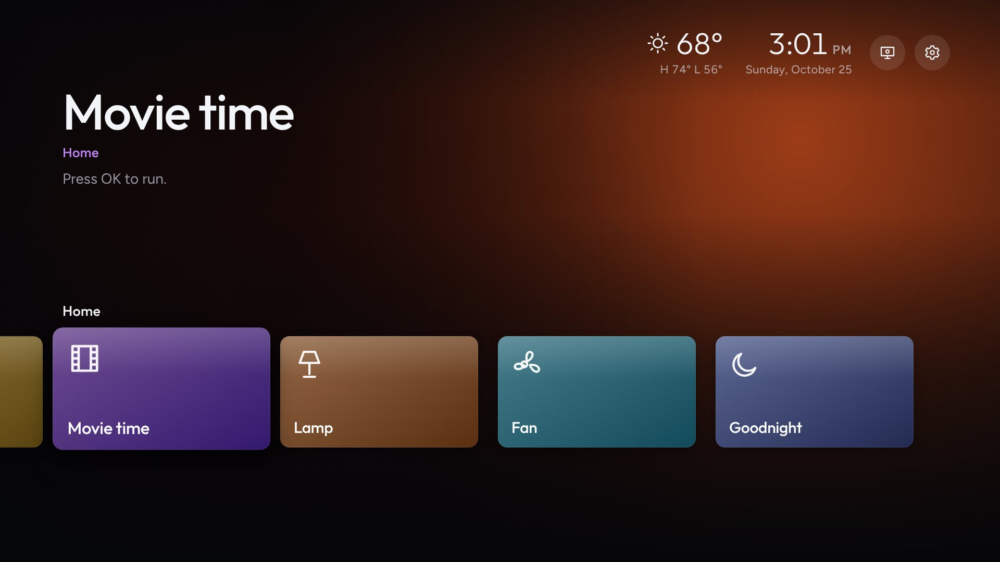
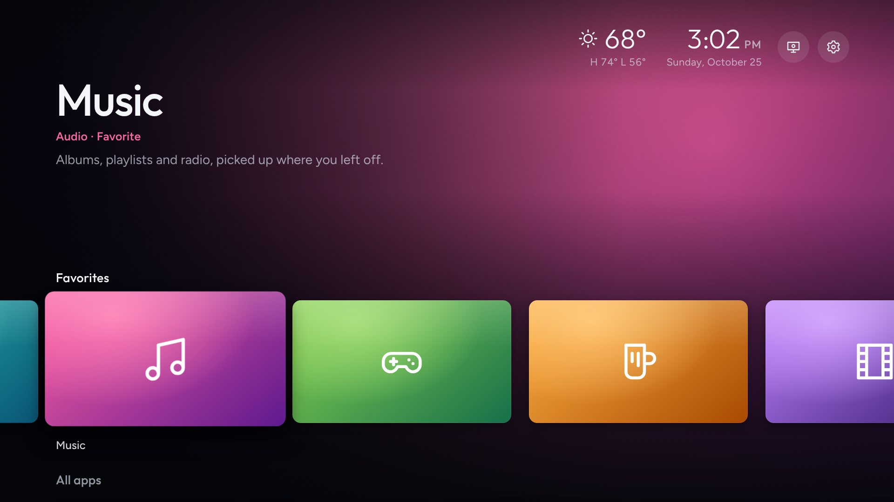

# Lumen Launcher

A home screen for rooted LG webOS TVs in the style of Apple TV and Projectivy Launcher: a big title for the focused app, a backdrop that takes its colour from that app or from a photo wallpaper, cards that lift as you move, and smooth scrolling.



## Features

- **Your apps and inputs** in Favorites, All apps and Inputs rows. Read from the same list LG's own home bar uses, with HDMI inputs shown under the names you gave them.
- **Cards that match their icons:** each card takes its icon's edge colour, so icons never sit as a square inside the card.
- **Wallpapers:** a dynamic colour field from the focused app, gradients, or high-resolution photos (Wikimedia Commons featured pictures, Bing daily photos, NASA Astronomy Picture of the Day, a custom topic or a subreddit), with credits, rotation and slow drift.
- **Weather next to the clock:** current temperature and today's high and low, from Open-Meteo (free, no account).
- **Home Assistant row:** tiles that run your automations through webhooks, no access token. See [docs/home-assistant.md](docs/home-assistant.md).
- **Up to see the wallpaper:** press Up once and the cards slide away; press Up again for TV settings and Lumen settings.
- **Settings in pages:** card shape and size, focus effect, accent colour (14 colours or Auto, which follows the focused app), clock, layout, Lite mode for slower TVs.
- **Built for TV hardware:** a single HTML file in ES5, with nothing animated but transform and opacity, and a glide mode when an arrow is held.

| Icon cards | Up: just the wallpaper |
|---|---|
|  |  |
| **Settings in pages** | **Accent colour, including Auto** |
|  |  |
| **Home Assistant row** | **Dynamic colours from the focused app** |
|  |  |

<sub>Screenshots are from Lumen's browser preview, which runs with sample apps and sample weather. They use the built-in gradient wallpapers (Aurora, Dusk, Ocean, Ember); on the TV you can also choose photo wallpapers.</sub>

## Requirements

- An LG TV on webOS, **rooted**, with the [webOS Homebrew Channel](https://github.com/webosbrew/webos-homebrew-channel) installed and its root service enabled. Lumen uses the root service to read the app and input lists, which webOS refuses to ordinary apps. Developed and used daily on webOS 10; it should work on webOS 4 and later.

## Install

Download `org.webosbrew.lumen_<version>_all.ipk` from [Releases](../../releases), then either:

- **From a PC with LG's CLI:** `npm install -g @webos-tools/cli`, run `ares-setup-device` once, then `ares-install org.webosbrew.lumen_<version>_all.ipk`.
- **Over SSH** (enable SSH in Homebrew Channel settings): copy the ipk to `/tmp` on the TV, then
  ```sh
  luna-send -n 1 'luna://com.webos.appInstallService/dev/install' '{"id":"org.webosbrew.lumen","ipkUrl":"/tmp/org.webosbrew.lumen_<version>_all.ipk","subscribe":true}'
  ```

Open **Lumen Launcher** from LG's launcher. To make a remote button open it, launch the app id `org.webosbrew.lumen`; for example, Home Assistant's webOS integration can call `system.launcher/launch` with `{"id":"org.webosbrew.lumen"}`.

## Using it

| Remote | Does |
|---|---|
| Arrows | Move |
| OK | Open the app or input |
| Hold OK, or Yellow | App options: favorite, move, hide |
| Up from the first row | Show the wallpaper; Up again for TV settings and Lumen settings |
| Red | Lumen settings |
| Green | Next wallpaper (photo wallpapers) |
| 0 or Blue | Debug log |

## Build from source

```sh
npm install                  # LG's ares CLI and the bundled fonts
python3 build.py             # src/launcher.html -> webos/index.html
python3 build.py --package   # also dist/org.webosbrew.lumen_<version>_all.ipk
```

All the app's code is in `src/launcher.html`: one file with inline CSS and ES5 JavaScript, no framework and no build step beyond bundling the fonts. Opening `webos/index.html` in a desktop browser runs a preview with sample apps.

Tests use Playwright with a simulated TV (`pip install playwright`), for example `python3 tests/test_home_assistant.py`. [CLAUDE.md](CLAUDE.md) has the full test list, the webOS quirks the code works around, and the version history.

## Credits

- Photo wallpapers come from their sources (Wikimedia Commons, Bing, NASA APOD, Reddit) and are shown with their credits; they aren't part of this repository.
- Weather from [Open-Meteo](https://open-meteo.com/).
- Fonts: Outfit and Figtree (SIL Open Font License), bundled from [Fontsource](https://fontsource.org/).
- Lumen isn't affiliated with LG.

## License

[MIT](LICENSE). The bundled fonts keep their own license (SIL Open Font License).
