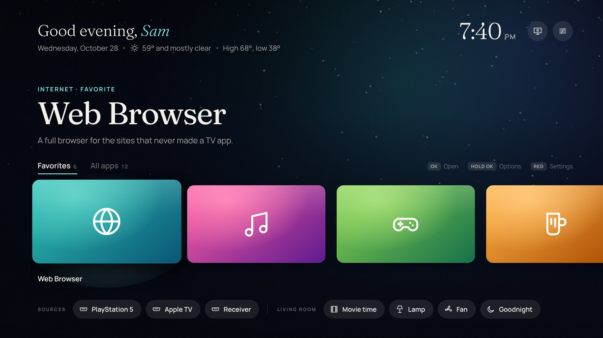
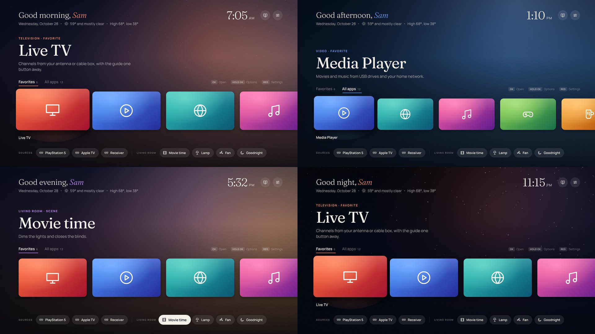
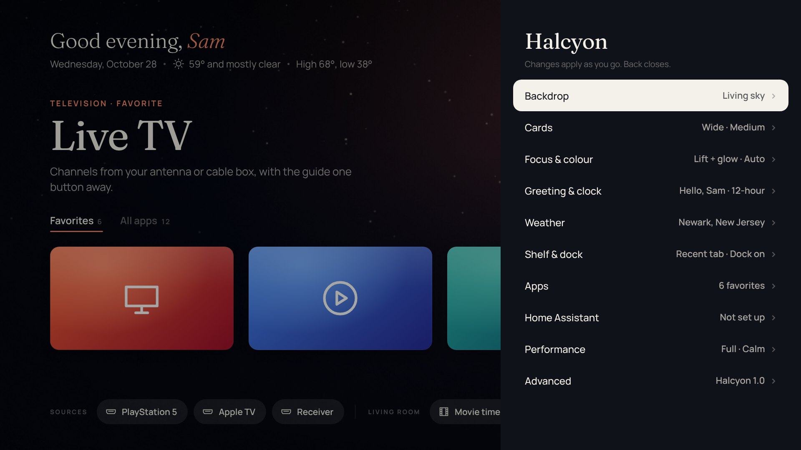

# Halcyon

A calm home screen for rooted LG webOS TVs. Halcyon greets you, tells you the weather in a sentence, and sits under a sky that follows the real time of day: rosy at dawn, clear blue at noon, amber at golden hour, starry at night.

It's a redesign of [Lumen Launcher](../README.md), built on everything Lumen learned on real hardware, but with its own layout, type and personality.



## What's different from Lumen

| | Lumen | Halcyon |
|---|---|---|
| **Backdrop** | Colour field from the focused app, or photos | A **living sky** that moves through dawn, day, golden hour, dusk and night, using your real sunrise and sunset, lightly tinted by the focused app. App colours, still ink and all of Lumen's photo topics are still there. |
| **Header** | Clock and weather, top right | "**Good evening, Sam**" in a serif, with the day and a weather sentence: *59° and partly cloudy · High 68°, low 41°* |
| **Layout** | Stacked rows: Favorites, All apps, Inputs, Home Assistant | **One shelf under tabs** (Recent · Favorites · All apps). Inputs and Home Assistant move into a **dock** of pills along the bottom. |
| **Recent** | — | A **Recent** tab fills itself as you open apps |
| **Focus** | Lift, shadow, light sweep | Lift and shadow, with a soft **glow in the app's own colour** that glides along under the shelf |
| **Type** | Outfit + Figtree | **Fraunces** (soft optical serif) + **Manrope** |

| Dawn, day, golden hour, night |
|---|
|  |

## Remote

| Button | On the shelf | Elsewhere |
|---|---|---|
| ← → | Move along the shelf; past the last app it runs on into the next category, before the first into the previous one | Switch tabs, move along the dock |
| ↑ | Up to the tabs; Up again and the shelf slides down so you can see the sky or photo; Up again for the Halcyon settings button (Left for TV settings). Down goes back the same way; OK or Back from the sky view returns to the cards. | |
| ↓ | Down to the dock (sources and scenes) | |
| OK | Open the app | Switch input, run a scene, open a tab |
| Hold OK / Yellow | Options: favorite, move, hide, remove from Recent | On a dock pill: hide that source or scene |
| Back | Back to the first card, then to Favorites | Close menus and settings |
| Red | Open or close settings | |
| Green | Next photo (photo backdrops) | |
| 0 / Blue | Debug log | |

## Settings

Pages, like Lumen's: **Backdrop** (living sky, app colours, still ink; photos: Landscapes, Astrophotography, Botanical, Nature, Sea & coast, Sky & clouds, Abstract & fractals, Bing photo of the day, NASA picture of the day, a custom topic or a subreddit; tint; dim), **Cards** (wide, square or icon; size; larger favorites; corner radius; names), **Focus & colour** (glow, ring or lift; zoom; accent: Auto follows the focused app), **Greeting & clock** (your name, 12/24-hour), **Weather** (place, °F/°C), **Shelf & dock**, **Apps** (choose favorites, reload apps and sources, unhide apps and sources, clear Recent), **Home Assistant**, **Performance** (Lite mode, animation speed, frame rate) and **Advanced**.



## Home Assistant

Same setup as Lumen ([guide](../docs/home-assistant.md)): webhook automations plus a tile list in Home Assistant's `www` folder. Halcyon reads `www/halcyon.json`, and falls back to your existing `www/lumen.json`, so a Lumen setup works unchanged. Scenes appear as pills in the dock under the file's `title`; pressing one sends a ring of the accent colour out from the pill. A message appears only if Home Assistant can't be reached or refuses.

## A source that should be gone

Halcyon shows the HDMI ports the TV reports as connected (or that the TV doesn't report either way). If one stays after you unplug it, press **0** for the debug log: the `inputs:` line lists exactly what the TV reported for every port. Hold **OK** on the pill and choose **Hide this source** to remove it either way; *Settings → Apps → Hidden apps & sources* brings hidden ones back.

## Install

Requires a rooted LG TV with the webOS Homebrew Channel.

```sh
cd halcyon
npm install                      # webOS CLI and the two font families
python3 build.py --package       # -> dist/org.webosbrew.halcyon_1.2.0_all.ipk
```

Then install the `.ipk` like Lumen: with `ares-install`, or over SSH:

```sh
luna-send -n 1 'luna://com.webos.appInstallService/dev/install' '{"id":"org.webosbrew.halcyon","ipkUrl":"/tmp/org.webosbrew.halcyon_1.2.0_all.ipk","subscribe":true}'
```

Halcyon and Lumen have different app ids and can be installed side by side.

## Tests

Playwright, with a simulated TV that denies every direct system call (as a real TV does) and answers through the Homebrew Channel's root service:

```sh
pip install playwright
python3 tests/test_tv.py             # apps and sources via root, icon edge colours, shelf/tabs/peek/top/dock navigation, launch, Recent, relaunch,
                                     # a source unplugged on the TV leaves the dock, hiding a source, menus
python3 tests/test_scenes.py         # Home Assistant: halcyon.json -> lumen.json fallback, unsafe ids dropped, one root-curl POST per press
python3 tests/test_sky_settings.py   # sky phases and greetings through the day, weather lookup and sentence, settings pages
python3 tests/test_wallpapers.py     # every photo topic, custom topic, subreddit through root curl
python3 tests/test_performance.py    # frame rate at 6x CPU throttle for each backdrop and Lite
```

Set `HALCYON_CHROMIUM=/path/to/chrome` to use a preinstalled browser. Screenshots go to `tests/shots/`.
